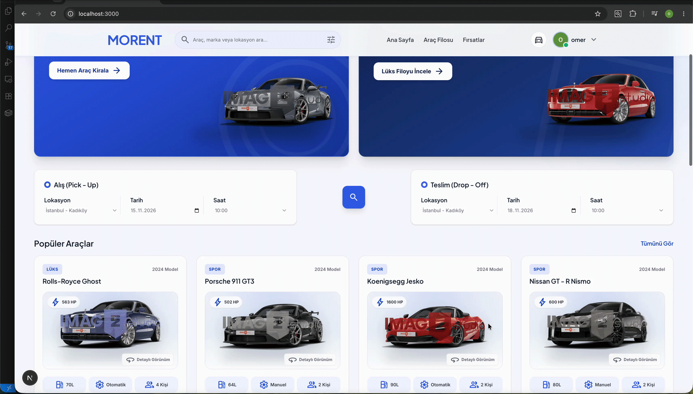
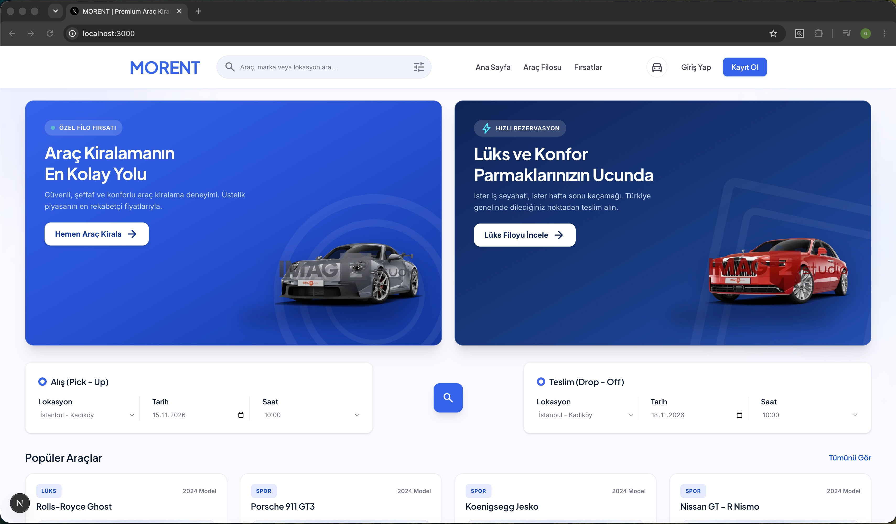

# 🚗 MORENT — Full-Stack Araç Kiralama ve Eş Zamanlı Ödeme Platformu

**MORENT (Rent-e-Car)**, modern web standartlarıyla geliştirilmiş; gerçek zamanlı araç filtreleme, rezervasyon yönetimi ve **Stripe tabanlı uçtan uca (Full-Stack) eş zamanlı ödeme mimarisine** sahip kapsamlı bir araç kiralama platformudur.

---

## 🤖 Yapay Zeka Destekli Geliştirme Vizyonu (AI-Assisted Engineering)

> **Geliştirici Notu:**  
> Daha önceki tüm projelerimi baştan sona tamamen kendim (manuel olarak) kodlayarak geliştirdim. Bu proje ise; modern yazılım dünyasında giderek kritik hale gelen **Yapay Zeka Destekli Yazılım Mühendisliği (AI-Assisted Development)**, **Mimari Prompt Mühendisliği (Prompt Engineering)** ve **Otonom Ajan Yönetimi (Agentic Workflows)** becerilerimi üst seviyeye taşımak amacıyla, yapay zeka araçlarıyla iş birliği içinde geliştirilmiştir.  
>  
> Süreç boyunca aşamalı mimari planlama (Phased Execution), kod inceleme, güvenlik doğrulaması ve karmaşık ödeme senaryolarının (Stripe Webhook & İdempotent Oturum Yönetimi) entegrasyonu yapay zeka orkestrasyonu ile gerçekleştirilmiştir.

---

## 🖼️ Proje Önizlemesi (GIF & Ekran Görüntüleri)

### 🎬 GIF


### 📸 Ekran Görüntüsü


## 🛠️ Kullanılan Teknolojiler ve Kütüphaneler

Proje, tip güvenliği, yüksek performans ve ölçeklenebilirlik odaklı modern bir teknoloji yığını (Tech Stack) üzerine inşa edilmiştir:

### Çekirdek Teknolojiler (Core Stack)
* **Next.js 16 (App Router & Turbopack):** Hem kullanıcı arayüzü (SSR / Server Components & Client Components) hem de Backend API katmanı (Route Handlers) için tek çatı altında full-stack çatı.
* **React 19:** Modern hook yapıları, sunucu bileşenleri ve optimize edilmiş DOM yönetimi.
* **TypeScript 5:** Veritabanı modellerinden API yanıtlarına ve Stripe olaylarına kadar uçtan uca katı tip güvenliği (Strict Type Safety).
* **Tailwind CSS v4:** Tasarım sistemine sadık, yüksek performanslı, duyarlı (responsive) ve modern arayüz tasarımı.

### Veritabanı, Kimlik Doğrulama ve Güvenlik
* **MongoDB & Mongoose ODM (v9):** İlişkisel referanslar (`User`, `Vehicle`, `Booking`), bileşik indeksler (Compound Indexes), şema doğrulamaları ve bağlantı önbellekleme (Singleton Connection Pooling).
* **NextAuth.js v5 (Auth.js):** JWT stratejisi tabanlı oturum yönetimi; hem **Google OAuth 2.0** sosyal girişi hem de **Credentials (E-posta/Şifre)** desteği.
* **bcryptjs:** Kullanıcı parolalarının tek yönlü kriptografik tuzlama (salting) ve özetleme (hashing) ile güvenle saklanması.
* **Next.js Proxy (`src/proxy.ts`):** Next.js 16 standartlarına uygun olarak korumalı rotaların (`/booking/*`, `/bookings`) ve kimlik doğrulama sayfalarının (`/login`, `/register`) sunucu uç katmanında denetlenmesi.

### Ödeme ve Yardımcı Araçlar
* **Stripe Node SDK (`stripe` v23):** Sunucu taraflı ödeme oturumları, dinamik katalog senkronizasyonu, iade yönetimi ve kriptografik webhook doğrulaması.
* **Node.js `crypto`:** Deterministik SHA-256 tabanlı İdempotency Key (Tekilleştirme Anahtarı) üretimi.
* **tsx & dotenv:** Veritabanı tohumlama (`db:seed`) ve ortam değişkeni yönetimi.

---

## 💳 Full-Stack ve Eş Zamanlı Ödeme Altyapısı (Stripe Mimarisi)

Projenin en güçlü yönlerinden biri, sadece basit bir ödeme yönlendirmesi yapmak yerine **üretim ortamı (production-grade) standartlarında, veri tutarlılığını garanti eden çift yönlü ve eş zamanlı bir ödeme yaşam döngüsü** sunmasıdır:

### 1. Dinamik Stripe Katalog ve Fiyat Senkronizasyonu (`syncVehicleStripeProduct`)
* Bir araç için ödeme başlatıldığında, sistem aracı önce Stripe kataloglarında `metadata['vehicleId']` ve `metadata['vehicleSlug']` üzerinden arar.
* Araç Stripe üzerinde yoksa otomatik olarak `Stripe.Product` ve günlük kiralama bedeline karşılık gelen `Stripe.Price` nesnelerini oluşturur.
* Veritabanındaki günlük araç fiyatında bir değişiklik yapılmışsa, Stripe üzerinde yeni bir fiyat nesnesi tanımlanır, varsayılan fiyat güncellenir ve eski fiyatlar otomatik olarak pasife alınır.

### 2. Sunucu Taraflı Otoriter Fiyatlandırma (Authoritative Server-Side Pricing)
* İstemciden (Frontend) gelen hiçbir fiyat verisine güvenilmez.
* Kiralama gün sayısı, seçilen ek paketler (*Tam Kapsamlı Kasko*, *Ek Sürücü*, *4G Wi-Fi & GPS*) ve **%10 KDV / Hizmet Bedeli** tamamen sunucu tarafında kuruş (`cents`) hassasiyetinde hesaplanarak Stripe satır öğelerine (`line_items`) dönüştürülür.

### 3. İdempotent Oturum Üretimi ve Çifte Rezervasyon Koruması
* **Çakışma Kontrolü:** Aynı aracın seçilen tarih aralığında onaylanmış/ödenmiş başka bir rezervasyonu varsa işlem `409 Conflict` ile engellenir.
* **Deterministik Idempotency Key:** Kullanıcı bilgisi, araç ID'si, tarihler, ek paketler, toplam tutar ve 5 dakikalık zaman dilimi (`timeBucket`) **SHA-256** ile özetlenerek Stripe'a iletilir. Böylece kullanıcının ödeme butonuna art arda tıklaması durumunda mükerrer ödeme oturumları açılması önlenir.
* **Açık Oturumların İptali (`supersedeOpenCheckouts`):** Kullanıcı ödeme sayfasından geri dönüp aynı araç için yeni bir ödeme başlatırsa, önceki açık Stripe oturumu otomatik olarak sonlandırılır.

### 4. Gerçek Zamanlı Webhook Senkronizasyonu (`/api/webhooks/stripe`)
Ödeme durumu, kullanıcı tarayıcıyı kapatsa bile arka planda Stripe Webhook'ları ile eş zamanlı olarak veritabanına işlenir:
* **Ham Gövde (Raw Payload) İmza Doğrulaması:** `req.text()` ile alınan ham istek gövdesi ve `Stripe-Signature` başlığı `stripe.webhooks.constructEvent` ile doğrulanarak sahte istekler reddedilir.
* **Eş Zamanlı Olay Yönetimi:**
  * `checkout.session.completed` & `checkout.session.async_payment_succeeded` → Rezervasyonu **Ödendi (`odendi`)** ve **Onaylandı (`onaylandi`)** durumuna geçirir.
  * `payment_intent.payment_failed` & `checkout.session.async_payment_failed` → Başarısız ödeme nedenini kaydeder ve kullanıcıya aynı oturum süresi içinde **tekrar ödeme denemesi** imkanı tanır.
  * `checkout.session.expired` → 30 dakikalık ödeme penceresi dolduğunda rezervasyonu otomatik olarak **`suresi_doldu`** statüsüne çeker.
  * `charge.refunded` → Stripe üzerinden yapılan iadeleri algılayarak rezervasyonu **`iade_edildi`** olarak günceller.

### 5. Çift Katmanlı Doğrulama (Dual-Layer Verification) ve Zaman Aşımı Süpürücüsü
* **Success Sayfası Fallback Mekanizması (`verifyAndConfirmStripeBooking`):** Kullanıcı ödeme sonrası `/booking/success` sayfasına döndüğünde, olası bir webhook gecikmesine karşı sistem doğrudan Stripe API üzerinden oturumu sorgular ve ödemeyi anında onaylar (Idempotent & Race-Safe Upsert).
* **Otomatik Süre Sonu Temizliği (`expireStaleCheckouts` & `/api/cron/expire-checkouts`):** 30 dakikalık ödeme süresi dolan açık rezervasyonlar hem kullanıcı sorgularında hem de zamanlanmış görev (Cron) uç noktasında Stripe ile uzlaştırılarak kapatılır.

---

## 🧠 Mimari Yöntemler ve Mühendislik Pratikleri

* **Hibrit Render Mimarisi:** SEO ve ilk yükleme performansı için ana sayfa, araç listeleme ve detay sayfalarında **React Server Components (RSC)**; interaktif filtreleme, tarih seçimi ve ödeme tetiklemelerinde **Client Components** kullanılmıştır.
* **Veritabanı Seviyesinde Filtreleme ve Sayfalama:** Araç kataloğu; kategori, marka, vites tipi, yakıt türü, koltuk sayısı, fiyat aralığı ve sıralama ölçütlerini doğrudan MongoDB sorgularıyla (`skip`/`limit` ve toplam kayıt sayısı метаverisiyle) işler.
* **Durum Makinesi (State Machine) Odaklı Rezervasyon Modeli:** Rezervasyonlar (`beklemede`, `onaylandi`, `tamamlandi`, `iptal`) ve ödemeler (`beklemede`, `odendi`, `basarisiz`, `suresi_doldu`, `iptal_edildi`, `iade_edildi`) birbirini ezmeden, sıra dışı (out-of-order) gelen ağ paketlerine karşı korumalı şekilde güncellenir.
* **Sıfır Backend Görsel Yükü:** Araç görselleri veritabanında binary olarak tutulmak yerine, slug tabanlı önyüz eşleştirme mimarisiyle (`vehicle-images.ts`) yüksek performanslı olarak sunulur.

---

## ⚡ Hızlı Kurulum

**1. Bağımlılıkları yükleyin:**
```bash
npm install
```

**2. Ortam değişkenlerini ayarlayın:**  
`.env.example` dosyasını `.env.local` olarak kopyalayın ve kendi anahtarlarınızı girin:
```env
MONGODB_URI=mongodb://localhost:27017/rent-e-car
NEXTAUTH_URL=http://localhost:3000
NEXTAUTH_SECRET=gizli-anahtariniz
GOOGLE_CLIENT_ID=google-client-id
GOOGLE_CLIENT_SECRET=google-client-secret
STRIPE_SECRET_KEY=sk_test_...
STRIPE_WEBHOOK_SECRET=whsec_...
CRON_SECRET=opsiyonel-cron-anahtari
```

**3. Örnek verileri yükleyin ve uygulamayı başlatın:**
```bash
npm run db:seed
npm run dev
```

**4. (Opsiyonel) Yerel ortamda eş zamanlı Stripe Webhook dinleyicisini başlatın:**
```bash
npm run stripe:listen
```
Uygulama varsayılan olarak `http://localhost:3000` adresinde çalışacaktır.

